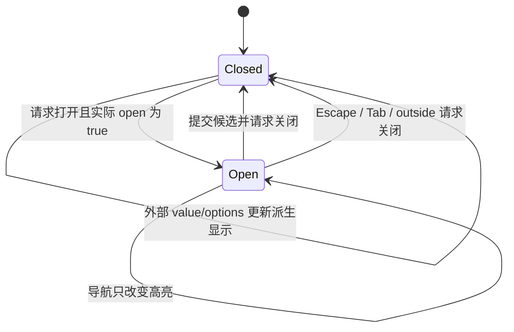

# Select / Combobox 共同契约

冻结日期：2026-10-29。Task8 契约 v1；以下是 Task9–13 的实施输入，尚未实现的公共导出不代表当前可用。产品支持范围见[组件矩阵](../components/README.md)。

Task8、Task9、Task10 已获用户验收通过。4.10 Core 六函数与十二个类型见 [Core 用法](../../packages/core/README.md)，4.11 DOM 能力见 [DOM 用法](../../packages/dom/README.md)。Task11 Vue Select 进入产品验收，实际 API/验证范围见 [Select 文档](../components/select.md) 与 [Task11 记录](../engineering/task11-acceptance.md)；Combobox、Dialog 和 React/Angular 产品仍待后续实施。

### 4.1 值、选项与输入归一化

类型与默认值必须结合[三框架映射](framework-adapters.md)阅读；模态层另见[Dialog 契约](dialog.md)。4.x 保留原计划编号，本文件为冻结后的语义来源。

Core 公共形状冻结如下；Task9 才增加正式导出，纯类型不生成无意义运行对象：

```ts
export type OptionValue = string | number;
export type SelectionValue = OptionValue | null;
export interface SelectionOption<V extends OptionValue = OptionValue> {
  readonly value: V;
  readonly label: string;
  readonly disabled?: boolean;
}
export type SelectionReason = 'option' | 'clear' | 'reset';
export interface SelectionChangeDetails<V extends OptionValue = OptionValue> {
  readonly value: V | null;
  readonly previousValue: V | null;
  readonly option: SelectionOption<V> | null;
  readonly reason: SelectionReason;
}
```

- `null` 是唯一业务无值；`0`、`''` 都合法；数字 `0` 与字符串 `'0'` 不相等。number 必须有限，`NaN/Infinity` 无效，-0 与 0 相等。不支持 boolean/object/symbol/bigint；省略/undefined/非法 JS value 在适配层归一为 null，并对非法值开发告警。不要用 `value || fallback` 判断无值。
- 标准 options 采用只读数组；label 是可过滤、可命名的文本。自定义渲染不替代 label，不把框架节点放进 Core。复杂业务字段由应用映射，不在本轮加入 fieldNames/对象值/compareWith。
- 未传 options 等同空数组；非法 JS 数组项跳过并在开发环境告警；重复的同类型 value 保留第一项，其余剔除。数字与字符串键不能相互覆盖。不修改传入数组/对象。
- 选中项删除后保留外部 value 所有权，显示未匹配占位，不自动请求清空；相同值重新出现后恢复显示。未匹配值不进入 HTML 提交，required 时视为无有效选择。
- disabled option 不允许用户新选；应用已赋给它的值仍可显示和提交。组件 disabled、disabled fieldset 与 option disabled 是三个不同层级。
- 枚举非法值回退已记录默认值；安全相关的非法 disabled/readonly 输入按不可修改处理并开发告警。各框架先进行自身 Boolean 转换，不能把字符串 `"false"` 当合法布尔输入示例。

### 4.2 首轮配置清单

下表是语义配置。Vue/React/Angular 的公共 props 类型分别定义，复用 Core 窄类型，不共享包含框架属性的“大 Props 接口”。

| 配置语义 | 类型/默认 | 行为与约束 |
| --- | --- | --- |
| 已选值 | `SelectionValue`；默认 `null` | 首轮始终受控；无绑定时仍发请求，但显示继续由输入值决定；不提供 defaultValue |
| options | `readonly SelectionOption[]`；`[]` | 标准结构、同步更新；不原地排序 |
| size | `sm / md / lg`；`md` | 几何、字体与 Button 基准一致 |
| disabled | boolean；false | 不可聚焦/打开/修改，不提交；与 fieldset/CVA disabled 合并 |
| readonly | boolean；false | 可聚焦、显示和提交已确认值，不打开/编辑/清空；不因 readonly 隐式 disabled |
| loading | boolean；false | busy 提示、阻止用户更改；保持可聚焦及已选值提交，不自动发请求 |
| clearable | boolean；false | 非空且可修改时显示独立清空按钮；name/aria-label 明确 |
| placeholder | string；`''` | 无有效匹配时的可见提示，不作为 accessible name |
| emptyText / loadingText / clearLabel | string；`暂无选项` / `加载中` / `清空` | 可直接替换文本，本轮不引入全局 locale 管理器 |
| open | `boolean | undefined`；undefined | 未提供由实例管理，初始 false；提供后由父层回写；不等同 selected value 非受控 |
| loop | boolean；false | 键盘到边界停止；true 才循环；跳过 disabled 项 |
| placement | `bottom-start / bottom-end / top-start / top-end`；bottom-start | 可因边界碰撞 flip，最终实际位置可不同 |
| offset / matchTriggerWidth | 非负有限 number / boolean；4 / true | offset 单位 CSS px；宽度只约束浮层，不截断文字 |
| portal | boolean；false | 默认就近渲染以继承品牌、字体和密度 |
| getPopupContainer | `(trigger: HTMLElement) => HTMLElement | null`；未提供 | 仅适配层类型；portal=true 时需显式提供同主题 host；缺失、失效或跨 document 目标开发告警并安全回退 inline |
| id / name / form | string；未提供 | id 关联可见控件；name/form 用于提交桥接，form 支持外部表单 |
| required / invalid | boolean；false | required 参加真实原生校验；invalid 表达应用错误状态，不替代校验器 |
| aria-label / aria-labelledby / aria-describedby | 原生字符串；未提供 | 转发到实际交互元素，不丢给多根容器 |
| class/style、data-* | 框架对应类型 | 定义落点为组件外层；交互元素附加属性使用明确的 trigger/input 属性通道 |

不在行为 props 中复制主色、字体、字号、圆角等主题配置；这些使用 SCSS 默认值和 CSS 变量。DOM 容器函数、render 回调、slot 不进入 Core。

`open/query` 可选控制通道以首次渲染是否为 undefined 确定模式；实例内不切换模式，开发环境对切换告警。内部模式后来传入控制值时忽略该值并告警；受控模式后来收到 undefined 时仍保持受控，open/query 分别按 false/空串归一化并告警。受控通道父层拒绝回写时，实际状态继续服从旧输入，副作用也按实际状态维护；请求事件不等于已完成状态变化。不要在 Vue 宏默认值里把 undefined 过早改成 false/空串，导致无法区分内部模式。

### 4.5 HTML 表单与 reset

Task8 冻结以下桥接方案，并以最小浏览器夹具验证其可行性，再作为 Task11 产品验收项：

1. 一个唯一的具名 `input[type=hidden]` 负责提交已确认且有匹配项的 `String(value)`。无 name、null、未知值、组件/fieldset disabled 时不提交。合法空串提交 `name=''`，数字/字符串的相同字面值在 HTML 中都变成字符串，JS 模型保留原类型。
2. 使用无 name、单选、size=1 的原生 select 作为校验代理，首个直接子 option 的 value 为 `''`，表示无有效选择；另一个 option 使用固定非空内部值 `__zoom_selected__`，表示已有有效选择。合法业务空串也映射到有效哨兵，不直接拿业务空串判断 required。代理不重复提交业务字段；可见控件负责可访问名称。代理需可被浏览器校验，不能用 hidden/display:none 或 disabled 来规避必填。[WHATWG select](https://html.spec.whatwg.org/multipage/form-elements.html#the-select-element)
3. 代理 visually hidden、tabindex=-1；invalid 不冒泡，监听代理本身或 form capture。invalid 时阻止错误焦点落到不可见元素，转焦点到可见触发器/input，使用内部校验状态合成实际 aria-invalid，不修改只读 invalid prop。不要只在 jsdom 验证；三浏览器测试 checkValidity/reportValidity、submit 与焦点。代理的可访问隐藏策略需结合实际浏览器/辅助技术核验，不能因自动化通过就声称读屏完整覆盖。
4. required 判断“是否匹配有效选项”，因此合法 `''` 和 `0` 都通过。select 没有原生 readonly；组件 readonly 时显式取消代理 required 并清除 customValidity，具名 hidden 仍提交已确认值；loading 保留已有提交值但无有效选择时仍受 required 约束。
5. name/form 动态更新、外部 form 关联、同名多个字段、disabled fieldset 及其首个 legend 例外遵循浏览器真实 form owner/`:disabled` 结果。不能简单取 closest(fieldset) 就判断禁用。
6. 原生表单 reset 请求 value 回到 null，reason=reset，不自行改父层值；父层可保留或回写自己的初始值。query/open 的非受控通道清理到当前已确认标签/关闭；受控通道发对应请求。延后读取 reset 事件最终 defaultPrevented，避免组件先处理、后续应用监听器才取消。默认动作结束后再将原生代理与已确认模型对齐，避免代理先重置造成模型失配。最终被 preventDefault 时不做组件重置。
7. 同一实例在一次 reset 中只请求一次；相同 null 不重复发 value change。Angular Forms 的 control/form reset 通过 writeValue 接收模型，不额外反调 onChange，也不能与原生 reset 重复处理。表单桥接监听和 invalid 监听均随 form owner 变化解绑并重建。
8. 代理和具名 hidden 均留在原组件/fieldset 树内，不能随 popup portal；二者同步 form 属性。校验代理是内部实现，不在公共 MD 承诺固定 DOM 结构。[WHATWG 校验与重置](https://html.spec.whatwg.org/multipage/form-control-infrastructure.html)

方案依据与实测范围见 [ADR-0001](../engineering/adr-0001-selection-foundations.md) 和 [Task8 验收](../engineering/task8-acceptance.md)。测试夹具不导出产品 API，Task10/11 仍须独立实现、回归；不得退化为 hidden+required 并保留“支持原生校验”的描述。

### 4.6 Select 交互状态



以上箭头表示父层接受后的实际转换；open 受控且被拒绝时不提前关闭或清理仍需工作的监听。

- 使用 select-only combobox + listbox/option；DOM 焦点保留在 trigger，aria-activedescendant 指向实际存在的高亮项。option 的 aria-selected 只表示已确认 value 匹配，不跟随高亮；暂态位置以 data-zoom-highlighted 表示。未知值和 null 时无 aria-selected=true。高亮项禁用/删除后先协调再产生 ARIA 引用。
- Enter/Space 打开；ArrowDown/Up 打开并导航；打开时 Home/End 到边界，跳过 disabled；Enter/Space 确认；Escape 取消未提交高亮并关闭。
- Tab 关闭并继续原生焦点移动，不因高亮自动提交；outside 不自动提交。首轮这一选择需写在文档，不能照搬参考示例的全部可选行为。
- 可打印字符使用 500ms 实例级 typeahead 缓冲，按 label 前缀导航；重复单字符可循环匹配同首字母项，不悄悄改 value。不拦截 Ctrl/Meta 组合键和中文 composition。
- 指针点击/触摸一次只确认一次。选项禁止嵌套链接/按钮等交互内容；clear 为独立的 type=button，不嵌套进另一个 button。

参考 [WAI select-only 示例](https://www.w3.org/WAI/ARIA/apg/patterns/combobox/examples/combobox-select-only/) 与[焦点/选择说明](https://www.w3.org/WAI/ARIA/apg/practices/keyboard-interface/)。参考用于定义模式，项目自己的提交/取消行为仍需测试。

#### 冻结的导航与 ARIA 断言

| 输入/状态 | 高亮与已确认值 | DOM/焦点断言 |
| --- | --- | --- |
| 关闭 | 不保留可供 ARIA 引用的高亮 | aria-expanded=false；不输出 aria-controls/activedescendant；popup 不存在 |
| Enter/Space 打开 | 当前匹配且 enabled 的选中项，否则首个 enabled | trigger 保持焦点；controls 引用本实例 listbox；不发 value 请求 |
| 关闭时 ArrowDown/Up | 已确认且 enabled 项，否则分别首/末 enabled；第一次按键只打开定位 | open 请求一次；不在同一按键额外跨过初始项 |
| 打开时 Up/Down、Home/End | next/previous、first/last；跳过 disabled | activedescendant 指向 enabled 高亮项；不改变 aria-selected |
| Enter/Space 确认 | 使用当前 enabled 高亮项；同值不发 value 请求 | 发送值请求再关闭请求；value 被拒仍显示旧选中项 |
| Tab、outside、Escape | 不提交；关闭后丢弃高亮 | Tab 不 preventDefault；Escape 阻止本层重复处理 |
| options 重排 | 按同类型稳定 value 保存高亮，不按索引保存 | option ID 在存活期内稳定；数字与字符串值不共用 ID |
| 高亮删除/禁用 | 先尝试 enabled 已选项，再首个 enabled，否则 null | 无候选时不输出 activedescendant，不能引用空 ID |
| 全禁用/空集合 | null | listbox 仍可显示空状态；无虚构 option、无 activedescendant |
| 父层拒绝关闭 | 实际 open 继续 true，高亮协调到仍有效的目标 | 保留当前 open 所需的监听、ARIA 与定位资源 |

typeahead 的 500ms 从最后一次有效字符计时；可打印空格在 Select 中保留给打开/确认，不进入缓冲。单字符重复（例如 aaa）按 a 从当前高亮之后循环查找，不受 loop=false 的箭头边界限制；多字符从当前高亮开始匹配，忽略 disabled。时间由适配层传入，Core 不启动 timer。

### 4.7 Combobox 输入与查询状态

`value` 是已提交业务值，`query` 是当前编辑文本，`highlightedValue` 是临时导航目标；三者不能共用一个 ref。

| 操作 | query/输入 | value | popup |
| --- | --- | --- | --- |
| 初始/外部值更新 | 非受控 query 同步匹配 label，无匹配则空串 | 服从外部输入 | 仅内部模式初始为 false；外部 value 变更不隐式改变 open |
| 普通编辑 | 更新 query；以 label 包含匹配过滤 | 不变 | 请求打开；高亮重算 |
| 选择已有项 | 请求 query=label | 请求选项 value | 请求关闭 |
| Escape | 恢复已确认 value 的 label | 不变 | 请求关闭 |
| Tab/离开整个控件 | 放弃未提交文本，恢复 label | 不变 | 请求关闭，保留原生焦点流 |
| 清空按钮 | 请求 query='' | 请求 null | 请求关闭 |
| 空结果 Enter | 保留编辑文本；不提交自由文本 | 不变 | 不生成新选项 |

query 默认由实例管理；提供 query 则应用必须按请求回写。外部值发生变化时同步 query 的规则也必须尊重 query 的受控所有权；按 4.3 固定发一次 reason=external-sync 的 query 请求，但不发 value change。外部强制重置到来时清除 composition 草稿，防止 compositionend 把过期输入写回。

配置增量：`query?: string`、`filterOption?: (query, option) => boolean`（默认 label 的确定性大小写不敏感包含匹配）、`minQueryLength?: number`（默认 0，非负整数）。不默认做拼音/语言相关排序，不在服务端/客户端依赖不同默认 locale；自定义 filter 必须纯函数，异常显式报告且安全产生空结果，不破坏输入事件循环。

IME 期间保留浏览器 composition 草稿，Enter 不确认选项、不提交表单、不重复发变更；compositionend 与紧接的 input 去重，再过滤/请求 query。原生左右方向键、Home/End、Ctrl/Meta 编辑、选区、复制粘贴不被列表导航接管；列表导航用 Up/Down，Tab 不阻止。已过滤列表中不存在的项不能被 aria-activedescendant 引用。[WAI combobox](https://www.w3.org/WAI/ARIA/apg/patterns/combobox/)

Combobox 输入 role=combobox、aria-autocomplete=list，焦点留在输入。open 且候选列表非空时 Up/Down 首次选择首/末 enabled；只有显式 Enter 或指针确认才请求 value。空结果 Enter 阻止由本次选项确认键引起的表单提交，不阻止独立 submit 按钮。minQueryLength 未满足显示 emptyText，不发远程请求。IME 草稿不驱动 query/过滤：compositionend 对当前有效编辑代提交一次 query；尾随 input 的同值同编辑代不再提交，新的同值输入不能被永久吞掉。composition 中 Escape/外部 reset/卸载使编辑代失效；过期 compositionend 忽略。blur 使用整个逻辑控件节点集合判定，不能仅监听 input 的 blur 就取消对自身 popup 的指针选择。

### 4.8 弹层、主题、SSR 与生命周期

- 默认 inline，就近继承颜色、字体、字号、density 和组件变量。portal=true 时显式解决裁剪问题，getPopupContainer 必须返回同 document 中存活的同主题容器；缺失或目标失效时告警并回退 inline。
- 外置到 body 后不会自动继承原祖先 CSS 变量；文档要求把品牌/density 配置也应用到浮层 host，或提供同主题 host。不加入隐式全局主题单例，也不承诺自动复制全部 computed style。动态主题变更必须同时覆盖触发器与目标 host。
- popup 定位 only while open；依赖 computePosition Promise 时使用会话序号/销毁标识，旧异步结果不能写进已经关闭、替换或卸载的节点。autoUpdate cleanup 在关闭/卸载/重建目标时执行。[Floating UI autoUpdate](https://floating-ui.com/docs/autoupdate)、[computePosition](https://floating-ui.com/docs/computeposition)
- outside 使用 ownerDocument 与 composedPath，包含 trigger、popup、clear、注册子层；同一个 pointerdown/点击不能既打开又马上关闭。仅顶部相关层响应 Escape/outside；React portal 的事件传播按 React 树，不能只靠 onClick 冒泡推断内外。[React portal](https://react.dev/reference/react-dom/createPortal)
- 模块导入和 Core/DOM 函数定义不访问浏览器全局；mount/open 才启动浏览器能力。Node 调用挂载函数时清晰报不支持环境，不产生半初始化资源。
- Vue SSR 使用 useId 或显式 id，不能使用随机数、模块级递增状态生成跨请求 ID。初始关闭/打开都输出可见控件；open=true 时 inline 输出列表。portal=true 的 SSR 与客户端首帧保持 inline，水合完成后才迁移到目标；不得在 hydrate 前改 DOM。[Vue SSR Teleports](https://vuejs.org/guide/scaling-up/ssr.html#teleports)
- SSR 请求隔离：选项、选择值、query、品牌、ID、层状态不共享可变单例。组件实例卸载后不残留 document listener、observer、timer、popup、滚动锁或 inert。
- Vue 产品 SSR 仅说明 Vue。React/Angular 日后各自证明初始状态、HTML、ID、水合、effect 清理；Angular SSR 未实施的状态保留在支持矩阵。

### 4.10 Core 最小公开集合（Task9 实现）

以下是冻结的类型签名，当前入口仍为空；禁止为通过检查提前放入占位实现。

```ts
type HighlightAction = 'next' | 'previous' | 'first' | 'last';
interface OptionIssue {
  readonly index: number;
  readonly code: 'invalid-option' | 'invalid-value' | 'invalid-label' | 'invalid-disabled' | 'duplicate-value';
}
interface NormalizedOptions<V extends OptionValue = OptionValue> {
  readonly options: readonly SelectionOption<V>[];
  readonly issues: readonly OptionIssue[];
}
normalizeOptions(input: unknown): NormalizedOptions;
getSelectedOption<V extends OptionValue>(options: readonly SelectionOption<V>[], value: V | null): SelectionOption<V> | null;
moveHighlight<V extends OptionValue>(options: readonly SelectionOption<V>[], current: V | null, action: HighlightAction, loop?: boolean): V | null;
reconcileHighlight<V extends OptionValue>(options: readonly SelectionOption<V>[], current: V | null, selected: V | null): V | null;
filterOptions<V extends OptionValue>(options: readonly SelectionOption<V>[], query: string): readonly SelectionOption<V>[];
findTypeaheadMatch<V extends OptionValue>(options: readonly SelectionOption<V>[], current: V | null, text: string): V | null;
```

全部规则接收已归一的 options（normalizeOptions 除外）；返回值不修改输入，输出对象只复制 value/label/disabled。外部未知输入先归一化，不向纯算法重复添加框架容错。输入不是数组时，undefined 返回空且无 issue，其他值返回 index=-1 invalid-option；非法项/值/label 跳过；非法 disabled 归为 true 并给 issue；重复类型敏感值只保留第一项。Core 只返回结构化诊断，不访问 console，开发告警由适配层去重输出。

getSelectedOption 可返回 disabled 已选项；导航永远跳过 disabled。moveHighlight 缺省 loop=false；current 不存在时 next/first 返回首项、previous/last 返回末项；到边界停在当前 enabled 项。reconcileHighlight 顺序为仍 enabled 的 current → enabled selected → 首个 enabled → null；无匹配 value 不请求清空。filterOptions 使用 label.toLowerCase().includes(query.toLowerCase())，不 trim、不调用 locale 排序、空查询保留全部项（含 disabled）；自定义过滤由适配层替换，异常报告后结果为空。findTypeaheadMatch 不保存计时/缓冲；重复单字符视作一个前缀并从当前之后循环，普通文本从当前开始环查，跳过 disabled；text='' 返回 null。

批准的类型导出是 OptionValue、SelectionValue、SelectionOption、SelectionReason、SelectionChangeDetails、QueryChangeReason、QueryChangeDetails、OpenChangeReason、OpenChangeDetails、HighlightAction、OptionIssue、NormalizedOptions。query/open 的详情为只读基础字符串/布尔值、上次值和 reason；不携带框架或 DOM 类型。

TS7 只以标准 ES2022 声明语法发出，禁止不兼容 TS6 的声明特性、框架对象或 DOM 环境引用。Task9 必须以真实生成的声明验证 TS6 和 TS7 正反例；Task8 只评审签名，现有平台类型门禁只证明已有声明和工程夹具的跨版本消费。

### 4.11 DOM 最小公开集合（Task10 实现）

所有 DOM 目标以 ownerDocument/defaultView 为准。以下接口中的数组均只读；Cleanup=()=>void 且幂等。配置更新通过 cleanup 后重建，只有定位提供 update；不增加通用订阅/全局服务。

```ts
type Cleanup = () => void;
type Placement = 'bottom-start' | 'bottom-end' | 'top-start' | 'top-end';
interface FloatingOptions {
  placement?: Placement; offset?: number; matchTriggerWidth?: boolean;
  onError?: (error: unknown) => void;
}
interface FloatingHandle { update(): Promise<void>; cleanup(): void }
mountFloating(trigger: HTMLElement, popup: HTMLElement, options?: FloatingOptions): FloatingHandle;
interface LayerContext { readonly ownerDocument: Document }
createLayerContext(ownerDocument: Document): LayerContext;
interface LayerOptions {
  nodes: readonly HTMLElement[];
  parent?: LayerHandle;
  onDismiss: (reason: 'escape' | 'outside', event: KeyboardEvent | PointerEvent) => void;
  closeOnEscape?: boolean; closeOnOutside?: boolean;
}
interface LayerHandle { cleanup(): void }
registerLayer(context: LayerContext, options: LayerOptions): LayerHandle;
isWithin(nodes: readonly HTMLElement[], target: EventTarget | null, event?: Event): boolean;
focusElement(target: HTMLElement | null, options?: FocusOptions): boolean;
restoreFocus(preferred: HTMLElement | null, fallback?: HTMLElement | null): boolean;
trapFocus(context: ModalContext, scope: HTMLElement, options?: { initialFocus?: HTMLElement | null }): Cleanup;
interface ModalContext { readonly ownerDocument: Document }
createModalContext(ownerDocument: Document): ModalContext;
acquireModal(context: ModalContext, options: { scope: HTMLElement; allowedNodes?: readonly HTMLElement[] }): Cleanup;
getFormOwner(control: HTMLSelectElement | HTMLInputElement): HTMLFormElement | null;
isFieldsetDisabled(control: HTMLElement): boolean;
observeFormBridge(options: {
  proxy: HTMLSelectElement; submission: HTMLInputElement; trigger: HTMLElement;
  onReset: (event: Event) => void; onInvalid: (event: Event) => void;
  onOwnerChange?: (owner: HTMLFormElement | null) => void;
}): { refresh(): void; cleanup(): void };
```

Floating defaults 为 bottom-start、4、true；异步失败由 onError 报告（未提供时 console.error），不得产生未处理拒绝。内部 computePosition 不向消费者暴露三方全部类型。cleanup 使未完成请求失效；update 在清理后返回已完成 Promise、不写 DOM；同 document 的连通节点才允许挂载，否则在任何监听建立前抛明确错误。width 为 trigger rect.width，最大高度按可用空间约束；absolute 策略，RTL 的 start/end 由定位库解析。

Layer 按注册顺序选择逻辑顶层，parent 只表达祖先关系，父层不能被早于其子的事件穿透。onDismiss 是请求，不能自行移除 layer；父层拒绝关闭时重复的独立用户意图可再请求。同一个 PointerEvent 只路由一次；composedPath 包括 Shadow DOM；父层逻辑内部含已注册子层的节点。顶层 closeOnOutside/closeOnEscape=false 时吞掉本次下传机会，不关闭更低层。最后一个 layer 清理时卸载文档监听；context 是显式实例，不在模块级缓存 Document/状态。

trapFocus 仅用于 modal；Tab/Shift+Tab 环绕 scope 内可聚焦节点，全部不可聚焦时聚焦具有 tabindex=-1 的 scope。trapFocus 与 acquireModal 必须传入同一 ModalContext；context 按 acquireModal 登记的 scope 顺序调度，仅最上 scope 的 trap 激活。先 acquireModal 再 trapFocus；嵌套关闭后自动恢复前一个仍登记的 trap。任意顺序 cleanup 必须撤销该 scope/trap 的资源和待执行焦点操作，不影响其他实例；不得另建模块级 document 栈。acquireModal 负责背景 inert 和滚动锁的按文档引用计数，允许层节点不受隔离；保留/恢复原有 inline overflow/padding、inert 与 aria 属性，不能 inert 活动层祖先。焦点恢复顺序为存活且可聚焦的显式目标、原触发器、传入 fallback；无目标安全返回 false，不强制 body 获焦。

observeFormBridge 只做 owner 重绑、reset 最终取消状态观察、invalid 与 cleanup；不能保存 selected value/query。refresh 用于 form/name/disabled 变化后的同步重绑，监听 form ID/控件移动所需的 observer 在 cleanup 回收。reset 使用下一任务（例如 setTimeout(0)）读取最终 defaultPrevented，不能只用 queueMicrotask：可信用户点击触发时微任务可能在两个 listener 之间执行。回调在默认动作之后执行，adapter 发请求后 nextTick 再同步 proxy/submission。cleanup/owner 变化使待执行 reset 任务失效并清理计时器；invalid 在代理自身监听，回调同步阻止错误焦点并转到 trigger。表单代理与 popup 分别管理，禁止代理随 portal。

批准导出限于上列 12 个函数及其具名配置/handle/context 类型；Task10 不导出内部栈、全局单例、Floating UI 类型或 private probe。所有挂载/作用域函数在 Node 调用时用清晰的 unsupported-browser 错误退出，不留下半初始化状态；getFormOwner 等函数的参数也必须在使用前检查环境。

### 4.12 样式 token 冻结（Task11/12 实现）

下表每项同时应用于 `--zoom-select-*` 与 `--zoom-combobox-*`，默认值来自 design/styles/_defaults.scss 或明确的本次选择。组件公共变量不在 :root/祖先提前物化；在属性使用处按“组件变量 → 共享 token → Sass 默认值”回退。仅文档冻结，本 Task 不增加产品 CSS。

| 后缀 | 合法 CSS 类型 | 默认/共享回退 |
| --- | --- | --- |
| font-family | font-family 列表 | --zoom-font-family / system-ui 等既有字体栈 |
| font-size | length/percentage | --zoom-font-size-sm/md/lg / 12/14/16px 基于 rem |
| line-height | number/length/percentage | --zoom-line-height / 1.5 |
| radius | 非负 length/percentage | --zoom-radius-md / 0.375rem |
| min-block-size | 非负 length | --zoom-control-min-size-sm/md/lg；regular 28/36/44、compact 24/28/36px（rem） |
| padding-inline | 非负 length/percentage | --zoom-control-padding-inline-sm/md/lg；regular 10/14/16、compact 8/10/14px（rem） |
| padding-block | 非负 length/percentage | --zoom-control-padding-block / regular 6、compact 4px（rem） |
| gap | 非负 length/percentage | --zoom-control-gap / regular 8、compact 6px（rem） |
| bg / fg | color | --zoom-color-surface / #fff；--zoom-color-text / #111827 |
| border-color | color | --zoom-color-border / #6b7280 |
| focus-color | color | --zoom-color-focus → --zoom-color-primary / #2563eb |
| popup-bg | color | --zoom-color-surface / #fff |
| popup-max-block-size | 非负 length | 20rem（并受当前可用空间约束） |
| option-bg-hover | color | color-mix(in srgb, var(--zoom-color-primary, #2563eb) 8%, transparent) |
| option-bg-selected | color | color-mix(in srgb, var(--zoom-color-primary, #2563eb) 16%, transparent) |
| option-fg-selected | color | --zoom-color-text / #111827 |
| z-index | integer/auto | 1000；嵌套宿主由应用保证 stacking context |

边框 1px solid，focus-visible 用共享 2px outline + 2px offset；disabled opacity=.55，loading 与 readonly 不降低正文可读性；empty/loading 使用共享 muted 文本色。内部选项 padding/gap 复用控件 token，不增加独立无约束 props。无固定 block-size；长 label 换行，逻辑属性支持 RTL，rem 与用户覆盖可增长。reduced-motion 时关闭可选过渡/旋转，状态提示保留。弹层 host 需要应用同步组件变量、density、字体；Task8 主题夹具只证明这种继承责任，产品 CSS 三浏览器几何验收仍属于 Task11/12。

